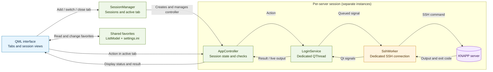

# ScriptExecutorApp – Developer and User Documentation

This guide describes how ScriptExecutorApp is structured, how an action is
executed from the click to the SSH server, and how to add another action button.

## Table of Contents

- [Overview](#overview)
- [Visual Design](#visual-design)
- [Prerequisites](#prerequisites)
- [C++ Conventions](#c-conventions)
- [Project Structure](#project-structure)
- [Login and Server Favorites](#login-and-server-favorites)
- [Multiple Servers](#multiple-servers)
- [How an Action Flows Through the Application](#how-an-action-flows-through-the-application)
- [Adding an Action Button](#adding-an-action-button)
- [Dashboard Buttons](#dashboard-buttons)
- [Caching Passwords and Credentials](#caching-passwords-and-credentials)
- [Build and Run on Linux](#build-and-run-on-linux)
- [Package the Windows Executable](#package-the-windows-executable)
- [Build with VS Code and CMake Tools](#build-with-vs-code-and-cmake-tools)
- [Notes for Changes](#notes-for-changes)
- [Feedback](#feedback)

## Overview

ScriptExecutorApp is a Qt desktop application for working with KNAPP servers
for KiSoft One. The user interface is rendered with QML. C++ manages the
application state and uses libssh to perform actions on the connected servers.
The application supports, among other things:

- SSH login and confirmation of an unknown or changed host key
- multiple simultaneous server connections with independent state per tab
- shared server favorites and pre-filled login details
- arbitrary shell commands and predefined actions
- display of command output while it is running and interactive input
- management of installed Git repositories and branches
- Oracle Data Pump export and restore
- cancellation of running commands, tab notifications, and server-specific logs

Remote commands run in an interactive, non-login Bash shell. In addition to
`~/.bashrc`, `~/.common.alias` is loaded. `~/.profile` is not executed.

## Visual Design

The interface uses the **Material Dark style of Qt Quick Controls** as its
foundation. Colors and components are customized with QML styles; the
unmodified default theme is not used.

| Design element | Implementation |
| --- | --- |
| Background | Dark navy tones (`#101f2c`, `#0b1520`) |
| Accent and focus | Turquoise/cyan (`#35c7e4`) |
| Text | Light text (`#e3edf5`) and subdued secondary text (`#9bb0c0`) |
| Surfaces and borders | Subtle contrast and rounded elements |
| Status and actions | Custom colors for running, successful, and destructive actions |

The design is intended for technical workflows: status, feedback, and the live
console output should be easy to recognize.

## Prerequisites

### For Use

- A supported desktop build of the application. On Windows, use the complete
  provided x64 package.
- A network connection to the target server over SSH. The application uses
  port `22` by default and currently supports login with a username and password.
- A valid user account on a reachable KNAPP Linux server (usually the klassx
  user). The host key must be confirmed on the first connection.
- The required tools and permissions for arbitrary commands and actions must
  already be available on the target server. They are not installed by the
  desktop application.
- Testing was performed on Platform 13.1.2 with KiSoft version 2.10. There are
  known issues with KiSoft 2.10 starting with Platform 14, so different
  commands may be required due to a major change in Platform 14.

### Target Server and Action Prerequisites

Remote commands require a Bash shell. The additional programs and permissions
needed depend on the selected action:

- Git/repository actions require `git` and access to the selected remote
  repository.
- Database actions require the appropriate Oracle environment and its
  programs, for example `sqlplus`, `expdp`, and `impdp`.
- **Setup Repository** and other reinstallation actions require the configured
  KiSoft environment (including `WCS_ROOT`, `KX_SRC_ROOT`, and
  `KLASSX_DB_CONNECT`), the build tools used for each step, and the required
  `sudo` permissions. The relevant system services must also exist for service
  actions.

Check the permissions and installation paths that apply to the server before
running an action. Installation and restore actions can change the server state.

### For Development and Building

- CMake `3.21.1` or newer
- A C++ compiler with C++17 support
- Qt `6.2` or newer with Core, Gui, Qml, and Quick; as well as the Qt Quick
  Controls/QML modules used by the interface
- libssh
- `pkg-config` for Linux and MinGW builds

On Linux, the distribution's development files and build tools are also
required. Windows additionally requires one of the documented toolchain
variants: MSYS2 MinGW64, a Windows build from WSL, or Visual Studio 2022 with
MSVC and vcpkg. Details are provided in [Build and Run on Linux](#build-and-run-on-linux)
and [Package the Windows Executable](#package-the-windows-executable).

## C++ Conventions

- **Naming:** Classes and structures use `PascalCase`, methods and local
  variables use `camelCase`, and constants use `UPPER_SNAKE_CASE`.

  - **Member variables**
    Mark them with the prefix `m_`. This makes them easier to distinguish from
    local variables. Example:

    ```cpp
    class Player
    {
    private:
      string m_name;
      int m_score;
    };
    ```

- **Lifetime and memory management:**
  - Use local variables for objects that are needed only within a function or
    a limited block. Their memory is released automatically when they leave
    scope.
  - Use Qt parent-child ownership for `QObject` objects when the child's
    lifetime is tied to the parent's. Pass the parent when creating the child;
    Qt deletes its child objects when the parent is destroyed. Do not also
    delete such a child manually.
    - **Memory management**
      In general, try to prefer stack allocation. It is up to the developer
      whether to use references or pointers, but smart pointers are recommended
      to prevent memory leaks. Also make sure to use `ptr` in pointer names.
      Example:

      ```cpp
      int *ptr = new int(10);
      std::unique_ptr<Player> ptrPlayer = std::make_unique<Player>("Name", "100");
      ```
  - Use raw pointers only for non-owning references when it is ensured that the
    referenced object outlives them. For owning pointers, it must be clear who
    releases the object.
- **Use const when appropriate**
  
    Mark parameters or method return values as constants to make it clear that
    they are not intended to be modified. Example:

    ```cpp
    void printSession(const Session& session):
    std::string& getSesssionName() const;
    ```

## Project Structure

| File or folder | Purpose |
| --- | --- |
| `main.qml` | Creates the tab bar and session views, shares favorites, and manages the active tab. |
| `content/App.qml` | User interfaces: login, dashboard, buttons, dialogs, and output. |
| `src/main.cpp` | Starts Qt/QML, creates the `SessionManager`, and exposes the manager and settings-file path to QML. |
| `src/App/SessionManager.hpp/.cpp` | Creates, activates, and removes the `AppController` instances used per server. |
| `src/App/AppController.hpp/.cpp` | Session state, UI actions, checks, log management, and result processing. |
| `src/LoginService/LoginService.hpp/.cpp` | Mediates between the controller and SSH worker and manages its thread. |
| `src/LoginService/SshWorker.hpp/.cpp` | SSH connection and remote commands, presets, Git, and Oracle actions. |
| `imports/ScriptExecutor/` | Shared QML helper components. |
| `CMakeLists.txt` and `CMakePresets.json` | Dependencies, build configuration, and build presets. |
| `scripts/dependencyInstaller.sh` | Installs build dependencies on Ubuntu/Debian; also runs `apt upgrade`. |

## Login and Server Favorites

The login screen accepts an IP address, username, and password for SSH login.
A name for the server favorite is optional. After a successful login:

- the IP address and username are pre-filled the next time the login screen is
  opened;
- the server is automatically saved as a favorite. If no name was entered, the
  name field remains empty; the IP address is used only as the visible fallback
  name for the favorite and tab;
- an existing favorite with the same IP address is updated instead of adding
  another entry.

Saved servers can be selected from the list: the IP address, username, and
favorite name are entered into the fields. The most recently selected favorite
IP is saved and selected again the next time the login screen is opened, if the
favorite still exists. If no selection is saved, the field shows “Select
favorite”. An entry can be removed using the red **x** next to it. If you log
in to that server successfully again, it is added as a favorite again.

The favorites list and its settings are shared by all server tabs. Changes such
as adding, updating, or removing a favorite are therefore immediately available
on the login screens in the other tabs as well.

The data is stored locally in `ScriptExecutorApp/settings.ini` in the
user-specific configuration directory:

- **Linux:** usually `~/.config/ScriptExecutorApp/settings.ini`
- **Windows:** usually
  `C:\Users\<username>\AppData\Local\ScriptExecutorApp\settings.ini`.
  The folder can be opened in Explorer using `%LOCALAPPDATA%\ScriptExecutorApp`.

The actual path depends on the system configuration. The file contains
favorites, the most recently selected favorite, IP addresses, usernames, and
favorite names, but no SSH passwords. This information is not stored encrypted;
handle the file accordingly.

If the favorites cannot be loaded, the application displays an error and
prevents changes to the favorites list so that existing data is not
overwritten. The `settings.ini` file should then be checked.

## Multiple Servers

Use the **+** entry in the tab bar to open another session. Each session has
its own `AppController`, `LoginService`, and `SshWorker`; therefore the SSH
connection, login status, active repository, command output, and running action
each have their own state. Switching tabs only changes the displayed session
and does not disconnect it.

The tab name is the favorite name, if one exists, or otherwise the server IP.
Long tab bars can be navigated with the arrows or by scrolling over the bar
with the mouse wheel. A connected tab can be closed after confirmation; a
running action prevents it from being closed. The last session cannot be closed.

If a command finishes, fails, or is canceled in an inactive tab, a notification
dot appears on that tab. The notification is cleared when you switch to that
tab. While a command is running, the tab shows an animated loading indicator.
Dialogs also show the name or address of the server whose session opened them.

### Responsibilities of the C++ Layers

- **`SessionManager`** owns the session controllers and manages their order and
  the active tab.
- **`AppController`** is the interface between the user interface and the
  application. There is one instance per server. It exposes QML properties and
  slots, checks the active repository type, among other things, and processes
  worker results.
- **`LoginService`** keeps the `SshWorker` in its own `QThread`. Calls and
  results are forwarded through Qt signals and slots.
- **`SshWorker`** performs the SSH and shell work. Its own thread keeps
  blocking network and process calls from blocking the user interface.

## How an Action Flows Through the Application



The `SessionManager` manages multiple sessions. Each session has its own
`AppController`/`LoginService`/`SshWorker` chain, its own SSH connection, and
its own command state. Sessions can connect to different servers or to the
same server. Favorites, on the other hand, are intentionally shared. Each
`SshWorker` runs in its own thread. This keeps SSH calls from blocking the user
interface. Command output can be returned in chunks through signals while the
command is running; after it finishes, the exit code and any error message are
also returned.

For a predefined button, the flow is typically:

1. QML calls `dashboardRoot.runPreset(...)`.
2. This function sets the running state and calls
   `appController.executePresetCommand(commandId)`.
3. `AppController` checks whether the action is allowed in the current state
   and forwards it to `LoginService`.
4. `LoginService` sends the action to the worker thread.
5. `SshWorker::executePresetCommand()` maps the ID to a shell command and runs
   it over SSH.
6. Output, errors, and the exit status are returned to the controller and the
   user interface.

The user interface prevents other actions while a command is running.
`AppController` also checks that a KiSoft-One repository is active for commands
and presets. `installRepository` is handled separately by the controller.

## Adding an Action Button

A simple preset consists of two connected parts:

1. a button in `content/App.qml`
2. a command mapping for the same ID in
   `SshWorker::executePresetCommand()` in `src/LoginService/SshWorker.cpp`

The ID connects the UI and C++. Use the same unique ID in both places.

### 1. Add a Button to the Dashboard

Place the button in the appropriate `ActionCard` and use the existing
`AnimatedCommandButton` pattern. Example:

```qml
AnimatedCommandButton {
    Layout.fillWidth: true
    text: "My action"
    iconText: "▶"
    Accessible.name: text
    enabled: !dashboardRoot.commandRunning &&
             dashboardRoot.kiSoftOneActive
    running: dashboardRoot.activeCommandButton === "myAction"
    clickHandler: function() {
        dashboardRoot.runPreset(
            "myAction",
            "My action is running ...",
            "myAction")
    }
}
```

Important details:

- `text` is the button label.
- `enabled` should match the action's state logic. For a regular KiSoft-One
  preset, the conditions above are a good example.
- `running` marks the button that is currently active.
- The first parameter of `runPreset` is the preset ID. The second text is used
  as a description in the command output. The third parameter is the button ID
  used for the running indicator.
- `runPreset` ignores clicks if a command is already running, sets the UI
  state, and calls the controller. Use this helper instead of reimplementing
  the flow in the button.

### 2. Map the Preset ID to a Command

Add a branch for the same ID to `SshWorker::executePresetCommand()`:

```cpp
} else if (commandId == "myAction") {
    command = "echo 'My action was executed'";
}
```

The branch belongs in the existing `if`/`else if` mapping, before its final
`else` rejects unknown IDs. The worker then calls
`executeCommandInternal(command, requestPty)`. For a non-interactive command
without `sudo`, `requestPty` can remain `false`.

A command that requires `sudo` or interactive terminal input must be handled
separately: check the existing presets and dialogs for
`runPresetWithSudoPassword`, `requestPty`, and input prompts. Do not simply add
a `sudo` command to the basic example.

### 3. Check and Test

1. Check that the QML call and C++ mapping use exactly the same ID.
2. Build and start the application (see [Build and Run on Linux](#build-and-run-on-linux)).
3. Log in to a suitable test system and check the button in the appropriate
   repository state.
4. Check both successful execution and error output and exit status.

A new signal, slot, or dedicated controller handler is normally not required
for a simple preset. If the action needs additional input, its own dialog, a
multi-step flow, or special result handling, the relevant properties, slots,
signals, and controller logic must also be added. First look for a similar
existing action and follow its pattern.

## Dashboard Buttons

The buttons are arranged in the dashboard in `content/App.qml`. The following
overview describes what the current actions do according to the implementation.

### Repository Actions

| Button | Effect |
| --- | --- |
| **Open Repository** | Opens the origin URL of the currently selected repository with the system's default application. |
| **Setup Repository** | Requests a repository URL, loads the available branches, and lets you select a branch. Before replacement, a warning is shown: the target repository is completely replaced, including local changes. After confirmation, the `klassx` sudo password is requested and automatically provided if the process prompts for it. After a successful replacement, the application immediately asks whether to start the installation. |
| **Switch Branch** | Loads branches from the installed repository. The selected branch is not just switched locally: the UI confirms complete replacement of the repository directory. Local changes and files may be lost. |
| **Fetch Branch** | Fetches the currently selected branch from the remote. It does not switch to the branch or update the working tree by merging. |
| **Pull Branch** | First checks that there are no local or untracked changes, fetches the branch, and updates it with a fast-forward. It aborts if there are local changes or divergent history. |

### Database Actions

| Button | Effect |
| --- | --- |
| **Dump DB** | Requests the `klassx` sudo password and the `BACKUPTOOL_USER` password. Oracle Data Pump then creates the `kisoft_schemas.dmp` dump file for `LU`, `AFCONFIG`, `ARCHIVE`, `KLASSX`, `KXGUI`, `KXREPORT`, and `USER_MANAGEMENT`. If `BACKUPTOOL_USER` is missing, the application checks for it and starts creating it. |
| **Load dumped DB** | First asks for confirmation and then requests the Oracle credentials. The restore resets the same seven target schemas and reimports them from the dump. Existing data in these schemas is deleted or overwritten. Use only with the appropriate dump and on a system intended for this operation. |
| **Rebuild Database** | Runs `make reinstall` in the WMW directory and automatically confirms the prepared updates requested there with `y`. |

The dump is stored on the connected Oracle environment in the Oracle
`DATA_PUMP_DIR` directory as `kisoft_schemas.dmp`; it is not downloaded to the
computer running the application. Subsequent exports use the same filename
(`REUSE_DUMPFILES=YES`) and overwrite an existing dump; no version history is
created. The restore also reads this file from `DATA_PUMP_DIR`. Sessions using
the same Oracle environment therefore share the file. Concurrent export and
restore actions there can interfere with each other.

### Reinstallation and Services

| Button | Effect |
| --- | --- |
| **Repository** | Requests the `klassx` sudo password and starts the complete installation: `setupBuildTarget.sh`, then `KXrelease.sh` or `KXrelease.sh -f` depending on the detected database state, followed by the Navigator build and restarts/starts of the associated services. |
| **Database** | Requests the sudo password, runs `make uninstall` and `make install` in the WMW directory, and then updates the KiSoft parameter tables. |
| **Navigator** | Requests the sudo password, rebuilds Navigator in the `afgui` directory with `xmkmf` and `make release`, and restarts the associated services. |
| **KiSoft** | Requests the sudo password, runs `make release` in the WCS directory, and then updates the KiSoft parameter tables. |
| **Refresh Dummy-Station Hosts** | Reads TCP host names from `station_parameter.xml` and adds missing entries to `/etc/hosts` using free addresses from the designated local address range. |
| **Status** | Runs the KiSoft-One `qking` status program and displays its output in the live console. |
| **Restart** | Restarts `kisoft-one.service` with `systemctl`. |
| **Stop** | Stops `kisoft-one.service` with `systemctl`. |

Installation, database, and service actions can significantly change the
server state. In particular, **Load dumped DB**, **Reinstall Database**,
**Rebuild Database**, **Repository**, and **Switch Branch** should only be
performed during an appropriate maintenance window, with the necessary
permissions, and on a verified target system. An exit code of `0` is not a
substitute for a functional check of the resulting server or database state.

### Other Controls

- **Log out** ends the SSH session.
- **Cancel command** requests cancellation of the running remote command.
- **Clear output** clears only the live console display.
- **Open logs** opens the current server's log folder.
- The search field filters the displayed console output; it does not change
  the remote command or delete a log file.

### Server-Specific Logs

Logs are stored in the application's working directory under `logs/`. A
separate subfolder is created for each server based on its favorite name; if
there is no name, the IP address is used. Invalid filename characters are
replaced:

```text
logs/
└── <server-name-or-IP>/
    ├── latest.log
    └── archive/
        └── <timestamp>_exit_<exit-code>.log
```

`latest.log` contains the most recently written command log. Commands with a
non-zero exit code are also archived in `archive/`. When the installed
repository is changed, only the archive for the currently active server is
cleared. Existing logs from the former global structure `logs/latest.log` and
`logs/archive/` are not moved automatically.

## Caching Passwords and Credentials

Passwords and Personal Access Tokens are not permanently stored in a file or
system keychain. IP addresses and usernames are stored permanently as
described in [Login and Server Favorites](#login-and-server-favorites). To
reuse them during a workflow, the QML interface temporarily keeps them as
`string` properties on the `dashboardRoot` object (in `content/App.qml`). This
is a simple in-memory buffer, not an encrypted vault or one protected against
memory access. The values are no longer available after the application closes.

### Existing Buffers

| Property | Contents and use | Lifetime according to the current code |
| --- | --- | --- |
| `oracleSudoPasswordCache` | `klassx` sudo password; used for Oracle, Database, Navigator, and KiSoft actions when matching password prompts appear. | Cleared after command completion, failure, or cancellation. |
| `oracleBackupPasswordCache` | `BACKUPTOOL_USER` password; reused for Oracle dump/restore prompts. | Cleared after command completion, failure, or cancellation. |
| `setupRepositorySudoPasswordCache` | `klassx` sudo password; automatically provided only for matching sudo prompts during the Setup Repository workflow. | Remains available during repository replacement and the subsequent installation while the installation is pending. Cleared after completion, failure, or cancellation. |
| `gitUsernameCache` and `gitPatCache` | Git username and Personal Access Token; after entry in the Git credentials dialog, further matching Git prompts are answered automatically. | Cleared when the Git credentials dialog is canceled and after command completion, failure, or cancellation. |
| `SshWorker::m_pendingPassword` | SSH login password; temporarily needed if the host key must be confirmed before login. | Cleared after the authentication attempt and discarded when the SSH session is cleaned up. |

For **Dump DB** and **Load dumped DB**, both Oracle passwords are entered in
`oracleCredentialsDialog`. When confirmed, the dialog copies the values to
`oracleSudoPasswordCache` and `oracleBackupPasswordCache`, clears the input
fields, and starts the action. When the worker reports a matching password
prompt, `onCommandInputRequested` looks up the value in the buffer and passes
it through `appController.submitCommandInput(...)`. If `BACKUPTOOL_USER` is
missing, it is created; the application answers both the new-password prompt
and its confirmation with the `oracleBackupPasswordCache` entered in the dialog.

For **Database**, **Navigator**, and **KiSoft**, the sudo password is first
entered in `reinstallSudoCredentialsDialog` and copied to
`oracleSudoPasswordCache`. For **Setup Repository**, it is requested after
branch selection and confirmation of the complete repository replacement, and
copied to the separate `setupRepositorySudoPasswordCache`. The password field
is then cleared; matching sudo prompts during repository replacement or the
subsequent installation are answered automatically. After a successful
download, the installation prompt appears immediately. The cache is cleared
if installation is declined, or if there is an error, cancellation, or
completion of the installation.

### Adding a Buffer for a New Credential Prompt

For a new action, extend the existing dialog/prompt flow instead of embedding
a password in a shell command:

1. Add an empty property under the `dashboardRoot` properties, for example
   `property string myPasswordCache: ""`.
2. On dialog confirmation, copy the value from the password field into this
   property and then call `passwordField.clear()`.
3. Answer only the expected prompt for the associated action with
   `appController.submitCommandInput(dashboardRoot.myPasswordCache)`.
4. Clear the property and input field when the dialog is canceled and when the
   command succeeds, fails, or is canceled. Do not rely on the user closing
   the application immediately.

The basic pattern of the existing Oracle buffers looks like this:

```qml
property string myPasswordCache: ""

function clearMyPasswordCache() {
    myPasswordCache = ""
    myPasswordField.clear()
}

// In the dialog's confirmation handler:
dashboardRoot.myPasswordCache = myPasswordField.text
myPasswordField.clear()

// In the appropriate onCommandInputRequested branch:
if (dashboardRoot.myPasswordCache.length > 0) {
    appController.submitCommandInput(dashboardRoot.myPasswordCache)
    return
}
```

Also connect `clearMyPasswordCache()` to the existing `onCommandCompleted`,
`onCommandFailed`, `onCommandCancelled`, and dialog-cancellation paths. Use
`echoMode: TextInput.Password` for password input. The Git buffers are cleared
through `clearGitCredentialsCache()` when a command ends (regardless of exit
code), fails, or is canceled. New buffers should follow the same pattern.

## Build and Run on Linux

CMake 3.21.1 or newer, a C++17-capable compiler, Qt 6.2 or newer, libssh, and
pkg-config are required. The project uses the `linux-dev` CMake preset:

```bash
cmake --preset linux-dev
cmake --build --preset linux-dev --parallel
./build/linux-dev/ScriptExecutorApp
```

On Ubuntu/Debian, `scripts/dependencyInstaller.sh` can install the required
packages. The script requires `sudo` and also performs a system upgrade
(`apt upgrade`); review it before running and consider the effects on the system.

In VS Code, select the CMake Tools `linux-dev` preset. **Build** and **Launch**
are then available through CMake Tools.

## Package the Windows Executable

The CMake target `package_windows` builds the application and places the `.exe`
together with Qt/QML plugins and the required runtime DLLs in a folder. To
distribute the application, share or zip the entire `windows-package` folder,
not just the `.exe`. The application runs locally on Windows; SSH commands
still run on the connected server.

### Variant A: Native Windows with MSYS2 MinGW64

These steps use the `windows-mingw64` preset. It expects MSYS2 in the standard
path `C:\msys64\mingw64`. Qt, libssh, the compiler, and build tools must all
come from the same MINGW64 environment; do not mix in MSVC packages.

1. Install MSYS2 from [msys2.org](https://www.msys2.org/) at the standard path
   `C:\msys64`.
2. Open **MSYS2 MINGW64** from the Start menu and install the tools:

   ```bash
   pacman -Syu
   ```

   If the update closes the terminal, open **MSYS2 MINGW64** again and install
   the project packages:

   ```bash
   pacman -S --needed \
     mingw-w64-x86_64-gcc \
     mingw-w64-x86_64-cmake \
     mingw-w64-x86_64-ninja \
     mingw-w64-x86_64-pkgconf \
     mingw-w64-x86_64-libssh \
     mingw-w64-x86_64-qt6-base \
     mingw-w64-x86_64-qt6-declarative \
     mingw-w64-x86_64-qt6-tools
   ```

3. Open **PowerShell** and navigate to the cloned project folder. Adjust the
   example path to your actual location:

   ```powershell
   cd "$HOME\development\ScriptExecutorApp"
   $env:MINGW_ROOT = 'C:\msys64\mingw64'
   $env:Path = "$env:MINGW_ROOT\bin;$env:Path"
   ```

4. Configure, build, and package:

   ```powershell
   cmake --preset windows-mingw64
   cmake --build --preset windows-mingw64-package
   ```

5. The finished package is located here:

   ```text
   build\windows-mingw64\windows-package\
   ```

   To test it, launch `ScriptExecutorApp.exe` from this folder. To distribute
   it, zip the entire folder. The `windows-mingw64-package` build preset runs
   both the build and packaging steps.

### Variant B: Package for Windows from WSL

This variant uses native Windows build tools from a WSL workspace. Linux CMake
cannot directly drive the MSYS2 Windows compiler; in addition, `cmd.exe`
cannot use a WSL UNC directory as its working directory. The script therefore
synchronizes the source files to `C:` and runs Windows CMake there with the
`windows-mingw64-wsl` preset.

Requirements are MSYS2 MinGW64 under `C:\msys64\mingw64`, enabled WSL
interoperability, and `rsync` in WSL. Run the following from the WSL project
folder:

```bash
./scripts/windows-build-from-wsl.sh configure
./scripts/windows-build-from-wsl.sh build
./scripts/windows-build-from-wsl.sh package
./scripts/windows-build-from-wsl.sh launch
```

The same actions are available in VS Code under **Tasks: Run Task**:
**Windows (WSL): Configure**, **Windows (WSL): Build**,
**Windows (WSL): Package**, and **Windows (WSL): Package and launch**.

The WSL source files remain the authoritative working copy. The script
synchronizes them to `C:\Users\Public\ScriptExecutorApp-src-wsl` (excluding
`.git`, `build`, and `CMakeLists.txt.user`). The build and package are located
under `C:\Users\Public\ScriptExecutorApp-build\windows-mingw64-wsl`.
For Linux builds, continue to use the `linux-dev` preset with CMake Tools.

### Alternative: Visual Studio and vcpkg

This variant uses the `windows-release` CMake preset with Visual Studio 2022,
MSVC x64, Qt for MSVC, and vcpkg. Do not use MinGW64 Qt or libssh libraries
for this build.

#### 1. Install the Prerequisites

Install:

- **Visual Studio 2022** with the **Desktop development with C++** workload
  (including MSVC x64 and the Windows SDK)
- **Git for Windows**
- **CMake 3.21.1 or newer**
- **Qt 6.2 or newer** through the Qt Online Installer

In the Qt Installer, select the Qt 6 entry **MSVC 2022 64-bit** and the Qt Base
and Qt Declarative (QML and Qt Quick) modules. The Qt installation must also
include `windeployqt.exe`; the packaging step uses it to collect the Qt/QML
runtime files. Example path: `C:\Qt\6.8.3\msvc2022_64`. Replace the version and
path in the following commands with the Qt folder actually installed.

#### 2. Install vcpkg

Open **Developer PowerShell for VS 2022** and run these commands once:

```powershell
git clone https://github.com/microsoft/vcpkg.git C:\vcpkg
& 'C:\vcpkg\bootstrap-vcpkg.bat' -disableMetrics
```

The repository contains a `vcpkg.json` that declares `libssh`. When the
project is configured, vcpkg automatically installs this dependency for the
`x64-windows` triplet.

#### 3. Configure and Package the Project

Continue using **Developer PowerShell for VS 2022**, navigate to the project
folder, and set the paths. Adjust the project and Qt paths to your installation:

```powershell
cd "$HOME\development\ScriptExecutorApp"
$env:VCPKG_ROOT = 'C:\vcpkg'
$env:QT_ROOT = 'C:\Qt\6.8.3\msvc2022_64'

cmake --preset windows-release
cmake --build --preset windows-release
```

During the first configuration, CMake needs internet access so that vcpkg can
download `libssh` and any missing Qt Design Studio components. The build
preset compiles the application and then runs the `package_windows` target.

The finished package is located under:

```text
build\windows-release\windows-package\
```

Launch `ScriptExecutorApp.exe` from this folder to test the package. Distribute
the complete folder or a ZIP of it; the `.exe` alone does not include the
required Qt/QML files and runtime DLLs.

If CMake cannot find Qt or vcpkg, first check that `QT_ROOT` points to the
folder containing `bin\windeployqt.exe` and
`lib\cmake\Qt6\Qt6Config.cmake`, and that `VCPKG_ROOT` points to the folder
containing `scripts\buildsystems\vcpkg.cmake`. The variables must be set in the
same PowerShell session in which CMake is started.

## Build with VS Code and CMake Tools

The **CMake Tools** extension (`ms-vscode.cmake-tools`) connects VS Code to
CMake: it detects the configure and build presets defined in
`CMakePresets.json`, configures the project, and provides build and launch
actions in the status bar and command palette. It does not automatically
install CMake, Qt, or the compiler; these tools must already be installed and
available as described above.

1. Open the project folder in VS Code.
2. Install **CMake Tools** by Microsoft (`ms-vscode.cmake-tools`) from the
   Extensions view. If you use **Remote - WSL**, install or enable the
   extension in the WSL context as well.
3. Select **CMake: [Configure Preset]** in the status bar and choose the
   appropriate preset:
   - `linux-dev` for a Linux build in WSL or Linux
   - `windows-mingw64` for a native Windows build
4. If CMake Tools asks, confirm **Configure**. You can also make the selection
   through the command palette (`Ctrl+Shift+P`) using
   **CMake: Select Configure Preset** and **CMake: Configure**.
5. For a regular compile, select **CMake: Build** from the command palette or
   use the build button in the status bar.
6. To create a distributable Windows package, first select
   `windows-mingw64-package` using **CMake: Select Build Preset**. Then run
   **CMake: Build**. For Windows builds from a WSL window, use the
   **Windows (WSL): Package** or **Windows (WSL): Package and launch** tasks
   instead.

If a preset does not appear in the list, check that VS Code has the repository
folder open, that CMake Tools is installed, and that the required tools and
`MINGW_ROOT` are available in the VS Code environment. After changing Windows
environment variables, close VS Code completely and restart it.

## Notes for Changes

- UI and presentation state generally belong in QML; application logic and
  state checks belong in the `AppController`.
- SSH and shell work belongs in the `SshWorker`; UI threads must not be blocked.
- New controller functions that QML calls must be declared as `public slots`
  or otherwise made explicitly available to QML.
- Do not suppress error messages: errors and exit statuses should remain
  visible to the UI through the existing signal path.
- Changes to existing presets can have server-side effects. Test them on a
  suitable system and pay particular attention to restart, stop, reinstallation,
  and restore actions.

## Feedback

If you have questions or suggestions, feel free to contact Thomas Milowiz.
